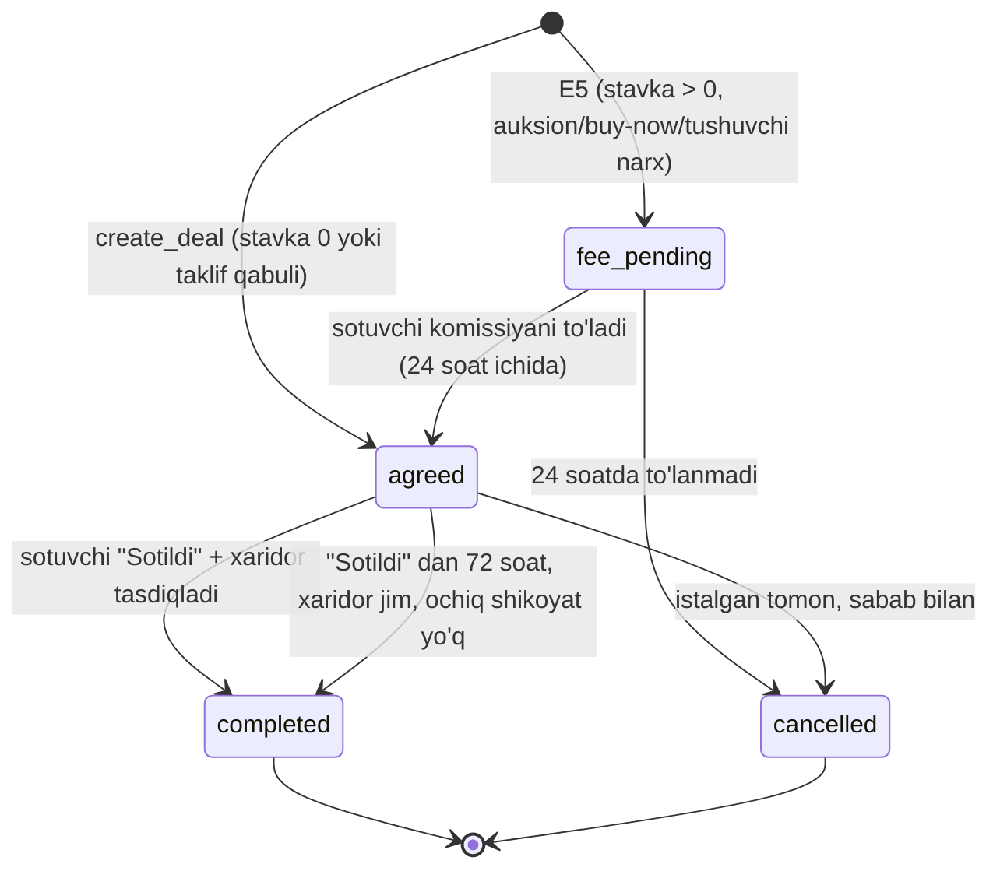

# Kelishuv (deal) modeli — Faza E

Holat: **reja** (kod E2 da yoziladi; hozircha kodda `orders` va to'lov oqimi bor — E1/E2 da almashadi).
Manba: Claude Docs hujjati "Bazart: Faza E, to'lovsiz kelishuv modeli va soddalashtirish rejasi"
(https://claude.ai/artifact/5865awHpiTvm44fudNLotm) va `docs/FAZA_E_BAJARISH_TARTIBI.md`.
Hujjat bilan solishtirildi: 2026-10-19.

**Asosiy g'oya.** Bazart to'lovda ishtirok etmaydi. Savdo **kelishuv** bilan tugaydi: narx va
miqdor qayd qilinadi, ikki tomonga bir-birining tasdiqlangan kontaktlari ochiladi, ular o'zlari
uchrashib hisob-kitob qiladi. Platforma kelishuvning holatini, tasdig'ini, bekor qilinishini va
ishonch signallarini (hisoblagichlar, sharhlar, shikoyatlar) boshqaradi.

---

## 1. Kelishuv qachon tuziladi

Hamma yo'l **bitta kirish nuqtasidan** o'tadi: `DealService.create_deal(...)` (E2.4). E5 komissiyasi
aynan shu funksiyaga ulanadi, shuning uchun boshqa joyda kelishuv yaratilmaydi.

| Manba | Qachon | Narx | Miqdor |
|---|---|---|---|
| Narx taklifi qabul qilindi | Navbatdagi tomon taklifni qabul qildi (`offer_service.accept`) | Kelishilgan dona narxi | Taklifdagi miqdor |
| Ko'tariluvchi auksion | Muddat tugadi, eng yuqori valid bid g'olib | G'olib bid | 1 |
| Buy-now (ko'tariluvchi) | Xaridor "hoziroq sotib olish" ni bosdi | Buy-now narxi | 1 |
| Tushuvchi narx | Xaridor joriy narxda sotib oldi (qulf ostida hisoblangan) | Shu lahzadagi narx | 1 |
| Keyingi bidderga taklif | G'olib javob bermagach sotuvchi yuborgan 24 soatlik taklif qabul qilindi | O'sha bidderning bid'i | 1 |

Kelishuv yaratilishi atomik: zaxira kamayishi (takliflarda), auksion yopilishi yoki xarid va kelishuv
bitta tranzaksiyada yoziladi (mavjud qulflar saqlanadi).

## 2. Ma'lumotlar (taxminiy)

| Ustun | Ma'no |
|---|---|
| `id`, `item_id`, `buyer_id`, `seller_id` | Ishtirokchilar va mahsulot |
| `auction_id` **yoki** `offer_id` | Manba (aynan bittasi — hozirgi `ck_orders_single_source` kabi) |
| `quantity`, `unit_price`, `final_price` | `final_price = calc_line_total(unit_price, quantity)` (tiyin) |
| `status` | `agreed` → `completed` \| `cancelled` (E5.2 da oldiga `fee_pending`) |
| `seller_marked_sold_at` | Sotuvchi "Sotildi" belgilagan vaqt (72 soatlik avto-tasdiq shundan hisoblanadi) |
| `buyer_confirmed_at` | Xaridor tasdiqlagan vaqt |
| `completed_at` | Yakunlangan vaqt |
| `cancelled_by_id`, `cancel_reason` | Kim va nima sababdan bekor qildi |
| `at_fault_id` | Bekor qilishda aybdor tomon (sababdan aniqlanadi, §7) — hisoblagich shunga yoziladi |
| `contacts_revealed_at` | Kontaktlar birinchi marta ochilgan vaqt (`agreed` ga kirganda) |
| `created_at`, `updated_at` | |

`cancel_reason` (taxminiy): `no_response` (javob bermadi), `changed_mind` (fikridan qaytdi),
`not_as_described` (mahsulot e'londagidek emas), `other`.

## 3. Holatlar

- O'tishlar faqat `deal_state` jadvali orqali (qo'lda `status = ...` taqiqlangan); jadval `fee_pending`
  qo'shilishiga tayyor bo'lishi kerak (E2.3).
- `completed` va `cancelled` — yakuniy.
- **Taklif (E2 da aniqlanadi):** xaridor sotuvchidan oldin tasdiqlasa, `buyer_confirmed_at` yoziladi va
  sotuvchi "Sotildi" belgilashi bilan kelishuv darhol `completed` bo'ladi.

## 4. Kontaktlar

- `GET /deals/{id}`: ikkinchi tomonning **tasdiqlangan telefoni** va **Telegram'i** faqat kelishuv
  ishtirokchisiga va faqat kontaktlar ochilgandan keyin (`contacts_revealed_at`): kelishuv `agreed`
  ga kirganda ochiladi. `fee_pending` da yopiq.
- **Ochilgan kontakt qayta yashirilmaydi:** kelishuv keyin `cancelled` bo'lsa ham ishtirokchilar bir-
  birining raqamini ko'rishda davom etadi (raqam allaqachon ma'lum — yashirish yolg'on himoya). Shu
  sababli kelishuv tuzilishidan oldin ogohlantirish matni ko'rsatiladi. `fee_pending` dan to'g'ridan-
  to'g'ri bekor bo'lgan kelishuvda kontakt hech qachon ochilmaydi.
- Begona foydalanuvchi (va admin bo'lmagan) kelishuvni ko'ra olmaydi — 404 (IDOR testi majburiy).
- Bid va taklif beruvchi ismining maskalanishi o'zgarmaydi; kontakt faqat kelishuvdan keyin.
- Telefon tasdig'i (OTP) bid, taklif va e'lon yaratish uchun majburiy (E2.1) — ochilgan raqam doim
  tasdiqlangan bo'ladi.

## 5. Amallar

| Endpoint | Kim | Shart | Natija |
|---|---|---|---|
| `POST /deals/{id}/complete` | Sotuvchi | `agreed` | `seller_marked_sold_at`; xaridor allaqachon tasdiqlagan bo'lsa — `completed` |
| `POST /deals/{id}/confirm` | Xaridor | `agreed` | `buyer_confirmed_at`; sotuvchi belgilagan bo'lsa — `completed` |
| `POST /deals/{id}/cancel` | Ikkala tomon | `agreed` (va `fee_pending`) | `cancelled`, sabab majburiy |

**Avto-tasdiq** (Celery beat, E2.7): `seller_marked_sold_at + 72 soat` o'tgan, xaridor jim va kelishuv
bo'yicha **ochiq shikoyat yo'q** — `completed`. Ochiq shikoyat avto-tasdiqni to'xtatadi.

## 6. Yutgan xaridor javob bermasa (auksion manbali kelishuv)

1. Kelishuv tuzilgach **48 soatlik bog'lanish oynasi**.
2. Undan keyin sotuvchi `no_response` sababi bilan bekor qila oladi (oynadan oldin — mumkin emas).
3. So'ng sotuvchi tanlaydi:
   - **keyingi bidderga 24 soatlik taklif** — mavjud second-chance mexanizmi qayta ishlatiladi: g'olib
     bidi chiqarib tashlanadi, keyingi valid bid egasiga taklif; qabul qilinsa — yangi kelishuv
     (`create_deal`);
   - yoki mahsulotni **qayta joylash** (E3.6). Qayta joylash ochiq keyingi-bidder taklifini yopadi —
     bitta mahsulot ikki marta sotilmaydi.

## 7. Bekor qilish oqibatlari

| Holat | Oqibat |
|---|---|
| Ko'p donali taklif kelishuvi bekor | Donalar zaxiraga qaytadi; e'lon muddati o'tmagan bo'lsa yana `active` (E2.8, E3.7) |
| Bitta donali mahsulot kelishuvi bekor | Item `sold` → `unsold` (E3.7); sotuvchi qayta joylaydi yoki olib tashlaydi |
| Har bekor qilish | **Aybdor tomonning** hisoblagichi oshadi (`at_fault_id`, quyida) |
| E5 komissiyasi | Xaridor aybi bilan (`no_response`, `changed_mind` xaridor tomonidan) — hamyonga qaytadi; sotuvchi bekor qilsa yoki `not_as_described` bo'lmasa — qaytmaydi (aniq qoida E5.2 da) |

**Aybdor tomon sababdan aniqlanadi:**

| Sabab | Aybdor |
|---|---|
| `no_response` | Bekor qilmagan tomon (javob bermagan) |
| `changed_mind` | Bekor qilgan tomon |
| `not_as_described` | Sotuvchi |
| `other` | Bekor qilgan tomon |

`no_response` ni suiiste'mol qilish xavfi: ikkinchi tomonga xabar boradi, e'tiroz shikoyat sifatida
admin'ga tushadi; takroriy holatlar fraud signali.

## 8. Hisoblagichlar va cheklov (E2.9)

Foydalanuvchida: tugallangan kelishuvlar; xaridor sifatida bekor qilganlari; sotuvchi sifatida bekor
qilganlari (aybdor sifatida); bid yoki ochiq takliflar bo'la turib olib tashlangan e'lonlar.

**Cheklov:** 30 kun ichida 3 ta bekor qilish → 14 kun bid va taklif taqiqi. Uchala son sozlamada.
Hisoblagichlar profilda ishonch signali sifatida ko'rinadi.

## 9. Sharhlar, shikoyatlar, bildirishnomalar

- **Sharh** faqat `completed` kelishuvga, har tomon bir marta (hozirgi `review_service` qoidasi
  `orders.completed` dan `deals.completed` ga o'tadi).
- **Shikoyat** kelishuvga ochilishi mumkin (`ComplaintTargetType` dagi `order` → `deal`); ochiq shikoyat
  avto-tasdiqni to'xtatadi. Admin ko'rib chiqadi — pul harakati yo'q, natija: ogohlantirish, blok,
  kelishuvni bekor qilish.
- **Bildirishnomalar** (in-app + Telegram): kelishuv tuzildi (kontaktlar ochildi), bekor qilindi
  (sabab bilan), yakunlandi; "Sotildi" belgilangani haqida xaridorga.

## 10. Ishonch: escrow o'rnini nima bosadi

Escrow yo'q, shuning uchun quyidagilar E2 ning **majburiy** qismi (keyinga qoldirilmaydi):

- UI ogohlantirishi: **"Mahsulotni ko'rmasdan oldindan to'lamang"** — kelishuv sahifasi va kontakt kartasida.
- Bid va taklif formasida: **"Bid — sotib olish niyati"**; bekor qilishlar hisoblagichga yozilishi aytiladi.
- Backlog (E2 dan tashqari): kelishuvgacha chatda telefon raqam va havolalarni yashirish.
- Kelishuv sahifasida shikoyat tugmasi.
- Hisoblagichlar va sharhlar ommaviy profilda.
- Foydalanuvchi shartlari: "Bazart to'lov va topshirishda ishtirok etmaydi" (yurist ko'rib chiqadi, E2.14).

## 11. E5 bilan bog'lanish (daromad)

- Komissiya **sotuvchidan**, `create_deal` ichida, bir kelishuv uchun bitta hamyon yozuvi (UNIQUE,
  `idempotency_key`).
- Taklif qabulida balans yetmasa — kerakli summa bilan xato; sotuvchi to'ldirib qaytadi.
- Auksion, buy-now, tushuvchi narx: kelishuv `fee_pending` da (kontaktlar yopiq) 24 soat; to'lanmasa —
  bekor, sotuvchi hisoblagichi oshadi. Stavka 0 bo'lsa `fee_pending` o'tkazib yuboriladi.
- `calc_seller_fee` faqat `app/money/` da (bps, min, max; pastga yaxlitlash).
