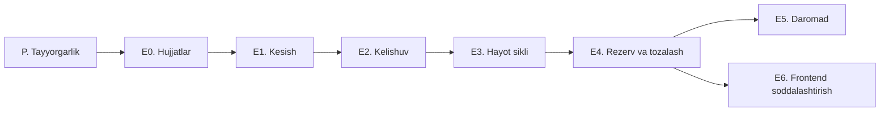

# Bazart: Faza E bajarish tartibi

Sana: 2026-10-19. Holat: reja, kod o'zgartirilmagan.

Manba: Claude Docs'dagi "Bazart: Faza E, to'lovsiz kelishuv modeli va soddalashtirish rejasi" hujjati, `HOW_IT_WORKS.md` tahlili, `CLAUDE.md` va `docs/ROADMAP.md`. Bu fayl o'sha hujjatni bajarish tartibiga aylantiradi: nima, qaysi ketma-ketlikda, qaysi tekshiruvdan keyin.

Eslatma: GitHub'dagi `main` (17-oktyabr) da takliflar, tushuvchi narx va `pricing_mode` yo'q, ular faqat sizning mahalliy nusxangizda. Barcha ishlar mahalliy (eng yangi) kodda bajariladi. Fayl nomlari GitHub nusxasidan olingan; mahalliy nusxada `P.5` dagi buyruq bilan tekshiring.

---

## 0. Bir qarashda



| Bosqich | Nima | Hajm (taxminiy) | Reliz |
| --- | --- | --- | --- |
| P | Baseline, branch, hajmni aniqlash | kichik | yo'q |
| E0 | Hujjat va qoidalarni yangilash | kichik | yo'q |
| E1 | To'lov, topshirish, nizo modullarini kesish | katta | E2 bilan birga |
| E2 | Buyurtma o'rniga kelishuv, kontaktlar, tasdiqlash | katta | E1 bilan birga |
| E3 | Mahsulot hayot sikli, olib tashlash, qayta joylash | o'rta | alohida |
| E4 | Rezerv va qolgan soddalashtirishlar | o'rta | alohida |
| E5 | Daromad: hamyon, komissiya, ko'tarish | katta | bayroq (flag) bilan |
| E6 | Sotuvchi formasi va yagona sahifa | o'rta | alohida |

**Reliz qoidasi.** E1 dan keyin buyurtmalar `pending_payment` da qotib qoladi (to'lov yo'q, kelishuv hali yo'q). Shuning uchun E1 va E2 bitta relizda chiqadi, oralig'ida hech qayerga deploy qilinmaydi.

---

## 1. Qabul qilingan qarorlar (o'zgarmaydi)

1. Bazart to'lovda ishtirok etmaydi: escrow, PSP, buyer premium (8%), topshirish kodi va nizolar chiqariladi.
2. Rezerv narx olib tashlanadi (`RESERVE_NOT_MET` va rezerv sabab berilgan second chance bilan birga).
3. Muddat (3/5/7 kun) faqat ikki rejimda: auksion va narx taklifi. Tushuvchi narx auksionning yo'nalishi sifatida qoladi.
4. Sotuvchi mahsulotni istalgan paytda olib tashlay oladi. Bidli auksion yoki ochiq takliflar bo'lsa ham ruxsat: bidderlarga xabar boradi, sotuvchi hisoblagichi oshadi. Ochiq kelishuv bo'lsa bloklanadi.
5. Sotilmay qolsa: sotuvchi olib tashlaydi yoki auksion yoki narx taklifi bilan qayta joylaydi. Yashirin avtomatik Dutch-fallback yo'q.
6. Kelishuv tasdig'i: sotuvchi "Sotildi" belgilaydi, xaridor tasdiqlaydi; 72 soat jim tursa avtomatik. Ochiq shikoyat bo'lsa avto-tasdiq to'xtaydi.
7. Yutgan xaridor javob bermasa: 48 soatlik bog'lanish oynasi, keyin sotuvchi bekor qiladi va keyingi bidderga 24 soatlik taklif yuboradi yoki qayta joylaydi.
8. Bekor qilish chegarasi: 30 kunda 3 ta bekor qilgan foydalanuvchiga 14 kunlik bid taqiqi (sozlanadi).
9. Daromad sotuvchidan olinadi (xaridordan emas).

## 2. Ochiq qarorlar

| Qaror | Qachongacha kerak | Tavsiya |
| --- | --- | --- |
| Komissiya sotuvchidan, kelishuv yaratilganda olinadi | E5.2 gacha | Ha |
| Boshlang'ich stavka | E5.2 gacha | 3% (300 bps), min 5 000, max 100 000 so'm (gipoteza); beta davomida 0 |
| Yig'ish usuli | E5.1 gacha | Sotuvchi hamyoni |
| Hamyonni boshida kim to'ldiradi | E5.1 gacha | Admin qo'lda, provayder keyin |
| Click/Payme/Uzum orqali faqat Bazart xizmat haqini qabul qilish "to'lovga aralashmaslik" qoidasiga zid emas | E5.4 gacha | Ha (yurist va provayder bilan tasdiqlanadi) |
| Xaridor aybi bilan bekor bo'lsa komissiya qaytariladi | E5.2 gacha | Ha |
| `core/webhook.py` va `webhook_events` ni E1 da saqlash | E1 boshlanishidan oldin | Saqlash (hamyon to'ldirish uchun kerak bo'ladi) |
| Foydalanuvchi shartlari matni (to'lovda ishtirok etmaslik, komissiya bandi) | Ochiq beta'dan oldin | Yurist ko'rib chiqadi |

---

## 3. Har bosqichga tegishli umumiy qoidalar

Buyruqlar (`CLAUDE.md` dan):

```bash
docker compose up -d db redis minio          # testlardan oldin; Postgres host'da 5433
pytest
ruff check . && ruff format --check .
alembic upgrade head                          # toza bazada
alembic check
```

- Har bosqich alohida branch/PR, har bosqich oxirida teg: `faza-e-p`, `faza-e-e0`, `faza-e-e1` va hokazo.
- Migratsiyani **toza bazada** sinash shart: testlar `create_all` ishlatadi va buzuq migratsiyani tutmaydi.
- Postgres ENUM'ni `create_table`/`add_column` ichida ishlatganda `postgresql.ENUM(..., create_type=False)`. Enum qiymatini o'chirib bo'lmaydi: yangi enum yaratib, ustunni unga o'tkazing.
- Beta boshlanmagani uchun real ma'lumot yo'q: buzuvchi migratsiya xavfsiz. Baribir har migratsiyaga `downgrade` yozing.
- Pul faqat butun tiyin (`app/money/`). `float` va `Decimal` taqiqlangan.
- Har pul, narx va auksion o'zgarishiga test majburiy. Mavjud parallel bid va parallel buy-now testlari har bosqichdan keyin **o'zgarishsiz** yashil bo'lishi kerak.
- Qatlam yo'nalishi: api, services, repositories, models. Teskari import yo'q.
- Biznes qoida o'zgarsa hujjat (`docs/`) shu commit'da yangilanadi.

---

## P. Tayyorgarlik

Kod o'zgarmaydi.

- [ ] P.1 (foydalanuvchi qarori: hozircha push qilinmaydi) Mahalliy kodni GitHub'ga push qiling (hozirgi `main` takliflar va tushuvchi narxsiz eski nusxa).
- [x] P.2 Toza muhitda baseline: `pytest`, `ruff`, toza bazada `alembic upgrade head` va `alembic check`. Hammasi yashil bo'lishi shart.
- [x] P.3 Teg: `pre-faza-e`.
- [x] P.4 Ish branch'i: `faza-e`; har bosqich alohida PR.
- [x] P.5 Hajmni aniqlash va natijani E1 ro'yxatiga qo'shing:

```bash
grep -rIlE "payment|escrow|handover|dispute|buyer_premium|webhook|psp|idempotency" app tests
grep -rIlE "payment|escrow|handover|dispute|premium" frontend --include=*.ts --include=*.tsx --exclude-dir=node_modules --exclude-dir=.next
grep -rIlE "reserve|second_chance|RESERVE_NOT_MET" app tests frontend --include=*.py --include=*.ts --include=*.tsx --exclude-dir=node_modules --exclude-dir=.next
```

P.5 natijasi (2026-10-19, `faza-e`): 1-grep — 59 fayl (app+tests), 2-grep — 24 fayl
(frontend), 3-grep — 39 fayl (reserve/second-chance). Ro'yxatlar E1 va E4 checklistlari bilan mos.

**Tekshiruv:** baseline yashil, teg qo'yilgan, ro'yxatlar saqlangan.

---

## E0. Hujjatlar

Maqsad: agent va dasturchilar eski qoidalarga tayanib adashmasligi uchun avval qoidalarni yangilash. Kod o'zgarmaydi.

- [x] E0.1 `CLAUDE.md` "O'ZGARMAYDI" jadvalidan olib tashlash yoki qayta yozish:
  - Escrow qatori: o'chadi.
  - Buyer premium 8%: o'chadi.
  - Auto-complete 72 soat: "kelishuv avto-tasdig'i 72 soat" deb qayta yoziladi.
  - Karta PAN: hozircha o'chadi (to'lov kodi yo'q).
  - "Idempotentlik" va "PSP webhook imzosiz qabul qilinmaydi": hamyon (E5) uchun saqlanadi, matni hamyon yozuvlariga moslanadi.
- [x] E0.2 Yangi qoidalar qo'shish: Bazart to'lovda ishtirok etmaydi; rezerv narx yo'q; muddat faqat auksion va taklifda; kontaktlar faqat kelishuvdan keyin ochiladi.
- [x] E0.3 `docs/DEALS.md` yozish (kelishuv modeli, hayot sikli; Claude Docs hujjatidan).
- [x] E0.4 `docs/ROADMAP.md`: Faza E qo'shish; Faza D "qamrovdan chiqarildi"; "Faza A–D tugamasdan yangi feature yo'q" qoidasini Faza E uchun yangilash.
- [x] E0.5 `docs/PAYMENTS.md` ni `docs/archive/` ga ko'chirish; `docs/AUCTION_ENGINE.md` da rezerv va second-chance bo'limlariga "E4 da o'chadi" belgisi.
- [x] E0.6 `README.md` ni haqiqiy holatga moslash (hozir eskirgan: "boshlang'ich skelet" deydi).
- [x] E0.7 `CLAUDE.md` dagi boshqa eskirgan joylar: sarlavhadagi "escrow" yechimi; "Yaxlitlash faqat `calc_buyer_premium` ichida" qoidasi (E5 da `calc_seller_fee` ga o'tadi); struktura va `docs/` jadvalidagi `payments`, `payment_service`, `PAYMENTS.md` havolalari; "36 test", "8 migratsiya" kabi eskirgan raqamlar.
- [x] E0.8 `docs/PROJECT_OVERVIEW.md`, `docs/ARCHITECTURE.md`, `docs/DOMAIN.md` ni yangi modelga moslash (escrow, buyurtma va to'lov jadvallari haqidagi bo'limlar).

**Tekshiruv:** hujjat commit qilingan, `git diff` da faqat `.md` fayllar.

---

## E1. Kesish (to'lov, topshirish, nizo)

Bog'liqlik: E0. Xavf: past (faqat o'chirish). **Deploy qilinmaydi**, E2 bilan birga chiqadi.

Tartib: tashqaridan ichkariga (frontend, testlar, endpointlar, servislar, modellar, migratsiya).

- [x] E1.1 **Frontend:** to'lov, topshirish va nizo sahifalari/komponentlarini o'chirish (`escrow-panel`, `dispute-*`, `orders/[id]/dispute`, to'lov tugmalari); `assurance-block` dagi "xavfsiz to'lov" matnini olib tashlash. Buyurtma sahifalari E2 gacha vaqtincha qoladi.
- [x] E1.2 **Testlar:** 10 ta fayl o'chadi: `test_auto_complete`, `test_disputes`, `test_escrow`, `test_handover`, `test_payment_security`, `test_payments`, `test_psp_escrow`, `test_psp_http_provider`, `test_webhook_events`, `test_webhook_verify`. 7 tasi qayta yoziladi: `test_admin`, `test_audit`, `test_orders`, `test_reviews`, `test_review_fixes`, `test_migrations`, `test_money`.
- [x] E1.3 **Endpointlar:** `payments`, `handovers`, `disputes` ni `router.py` dan chiqarish va fayllarni o'chirish.
- [x] E1.4 **Servislar:** `payment_service`, `payment_providers`, `payment_state`, `handover_service`, `dispute_service`, `auto_complete` (va uning Celery vazifasi) o'chadi.
- [x] E1.5 **Repozitoriylar va sxemalar:** `payment`, `handover`, `dispute` repozitoriylari; `payment` va `dispute` sxemalari o'chadi.
- [x] E1.6 **Webhook:** `core/webhook.py` (imzo tekshiruvi) va `webhook_events` (takrorlanishdan himoya) **saqlanadi**: hamyon to'ldirish (E5.4) shunga tayanadi. Faqat to'lov holatiga ulanish olib tashlanadi.
- [x] E1.7 **Modellar:** `payment`, `handover`, `dispute`; `order` dan `auto_complete_at`; `PaymentStatus`, handover va dispute enum'lari; `NotificationType` dan `PAYMENT`, `HANDOVER`, `DISPUTE`; `OrderStatus` dan `paid`.
- [x] E1.8 **Pul moduli:** `calc_buyer_premium` va `BUYER_PREMIUM_BPS` o'chadi; tiyin arifmetikasi qoladi.
- [x] E1.9 **Sozlamalar:** `allow_mock_payments`, PSP kalitlari, premium BPS; `.env.example` yangilanadi.
- [x] E1.10 **Audit:** `audit_log` admin harakatlari uchun qoladi; to'lov bilan bog'liq chaqiruvlari olib tashlanadi.
- [x] E1.11 **Migratsiya:** `payments`, `handovers`, `disputes` jadvallari, ularning enum'lari, `orders` dagi to'lov ustunlari o'chadi; notification enum'i yangi enum bilan almashtiriladi. `downgrade` yoziladi, toza bazada sinaladi, `test_migrations` yangilanadi.

**Tekshiruv:**
- `pytest` va `ruff` yashil; toza bazada `alembic upgrade head` va `alembic check` o'tadi.
- Parallel bid va parallel buy-now testlari o'zgarishsiz yashil.
- `grep -rIlE "payment|escrow|handover|dispute|premium" app` faqat ruxsat etilgan istisnolarni ko'rsatadi (webhook, audit).

E1 natijasi (2026-10-19): 349 test yashil (410 dan 61 tasi o'chirilgan modullar bilan ketdi);
toza bazada `upgrade → check → downgrade -1 → upgrade → check` o'tdi; parallel bid/buy-now testlari
o'zgarmagan. Grep qoldig'i: faqat `OrderStatus.PENDING_PAYMENT` (E2 da `deals` bilan ketadi).
Rejadan farqlar: `test_webhook_verify` saqlandi (u saqlanayotgan `core/webhook.py` ni sinaydi);
`test_webhook_events` servis darajasida qayta yozildi (endpoint yo'q, E5 qayta ulaydi). Oraliq
holat: `PENDING_PAYMENT → COMPLETED` o'tishi ochildi — sotuvchi sotuvni o'zi yakunlaydi (E2 gacha).

---

## E2. Kelishuv (buyurtma o'rniga)

Bog'liqlik: E1. Xavf: o'rta (holat mashinasi va ruxsatlar). E1 bilan birga reliz.

- [ ] E2.1 **Telefon tasdig'i majburiy:** bid, taklif va e'lon yaratish uchun API'da (OTP tayyor). Test fixture'lari yangilanadi.
- [ ] E2.2 **`orders` → `deals`:** jadval, model, repozitoriy, servis, endpoint (`/deals`), sxema, FK nomlari; migratsiya (nomini o'zgartirish).
- [ ] E2.3 **Holatlar:** `agreed`, `completed`, `cancelled`; `cancelled_by_id`, `cancel_reason` (taxminiy: javob bermadi, fikridan qaytdi, mahsulot e'londagidek emas, boshqa), `completed_at`. Eski `order_state` o'rniga `deal_state` (ruxsat etilgan o'tishlar jadvali); `fee_pending` E5.2 da qo'shiladi, shuning uchun mashina kengaytiriladigan bo'lsin.
- [ ] E2.4 **Yagona kirish nuqtasi `DealService.create_deal(...)`.** Taklif qabul qilish, auksion yopilishi (g'olib), buy-now va tushuvchi narxda xarid: hammasi shu orqali. Eski "order yaratish" chaqiruvlari almashtiriladi. E5 komissiyasi aynan shu funksiyaga ulanadi.
- [ ] E2.5 **Kontaktlar:** `GET /deals/{id}` da ikkinchi tomonning tasdiqlangan telefoni va Telegram'i faqat ishtirokchiga va faqat `agreed`/`completed` holatda. Bid va taklif beruvchi ismining maskalanishi o'zgarmaydi.
- [ ] E2.6 **Amallar:** `POST /deals/{id}/complete` (sotuvchi), `/confirm` (xaridor), `/cancel` (ikkala tomon, sabab bilan). Ruxsat va IDOR testlari.
- [ ] E2.7 **Avto-tasdiq job** (Celery beat): sotuvchi "sotildi" belgilagan, xaridor 72 soat jim, ochiq shikoyat yo'q, shunda `completed`.
- [ ] E2.8 **Bekor qilish oqibatlari:** ko'p donali taklifda zaxira qaytadi (mavjud mantiq saqlanadi); hisoblagichlar yangilanadi; item holati E3.7 da.
- [ ] E2.9 **Foydalanuvchi hisoblagichlari:** tugallangan kelishuvlar, xaridor sifatida bekor qilganlari, sotuvchi sifatida bekor qilganlari, bid/taklif bilan olib tashlangan e'lonlar. Cheklov: 30 kunda 3 bekor qilish, 14 kun bid va taklif taqiqi (sozlamada).
- [ ] E2.10 **Yutgan xaridor javob bermasa:** 48 soatdan keyin sotuvchi "javob bermadi" bilan bekor qiladi. Keyingi bidderga taklif: mavjud second-chance mexanizmi qayta ishlatiladi (g'olib bidi chiqarib tashlanadi, keyingi valid bid egasiga 24 soatlik taklif).
- [ ] E2.11 **Sharhlar** faqat `completed` kelishuvga ochiladi.
- [ ] E2.12 **Bildirishnomalar:** yangi turlar (kelishuv tuzildi, bekor qilindi, yakunlandi); Telegram matnlari.
- [ ] E2.13 **Frontend:** `/orders` → `/deals`; kontakt kartasi; "Sotildi", "Tasdiqlayman", "Bekor qilish" tugmalari; "Mahsulotni ko'rmasdan oldindan to'lamang" ogohlantirishi va shikoyat tugmasi; to'lov so'zlari tozalanadi.
- [ ] E2.14 **Shartlar matni:** "Bazart to'lov va topshirishda ishtirok etmaydi" (yurist ko'rib chiqadi; ochiq beta'dan oldin).

**Tekshiruv:**
- Holat mashinasi: taqiqlangan o'tishlar xato beradi.
- IDOR: begona foydalanuvchi telefonni ko'ra olmaydi; `fee_pending`/`agreed` dan oldin kontakt yo'q.
- Zaxira tiklanishi, avto-tasdiq (shikoyat bilan to'xtashi) testlari.
- Parallel bid va buy-now testlari o'zgarishsiz yashil.
- **E1 + E2 relizi** shu nuqtadan keyin.

---

## E3. Mahsulot hayot sikli

Bog'liqlik: E2. Xavf: o'rta (enum va holat ko'chirish).

- [ ] E3.1 **Item holatlari:** `draft`, `active`, `sold`, `unsold`, `removed`, `rejected`. Ko'chirish: `expired` → `unsold`; `cancelled` → `unsold` (auksion bidsiz tugagan bo'lsa) yoki `removed` (sotuvchi bekor qilgan) yoki `rejected` (admin rad etgan). Enum almashtirish migratsiyasi.
- [ ] E3.2 **`scheduled` olib tashlanadi:** `AuctionStatus.SCHEDULED`, closerdagi avto-aktivatsiya, `PATCH /auctions/{id}/pricing`, formadagi "Keyinroq boshlash".
- [ ] E3.3 **Dutch-fallback olib tashlanadi:** fallback roziligi va yashirin chegara ustunlari, `continued_as_auction_id`, closerdagi fallback tarmog'i, kuzatuvchilarni ko'chirish. `relisted_from_id` qoladi.
- [ ] E3.4 **Closer va taklif muddati job'i:** bidsiz tugagan auksion → item `unsold`; muddati o'tgan taklif e'loni → `unsold` (qolgan zaxira bilan). Telegram: "sotilmay tugadi, qayta joylang".
- [ ] E3.5 **`POST /items/{id}/remove`:** ochiq kelishuv bor → 409; bidli auksion yoki ochiq takliflar bo'lsa bidderlarga va taklif beruvchilarga xabar, hisoblagich oshadi, ochiq takliflar yopiladi; holat `removed`, ma'lumot o'chirilmaydi.
- [ ] E3.6 **`POST /items/{id}/relist`** (`mode`: ko'tariluvchi auksion, tushuvchi auksion, narx taklifi; narx; muddat 3/5/7 kun): faqat `unsold` mahsulot uchun; yangi e'lon nusxasi `relisted_from_id` bilan; "faqat bir marta" cheklovi olib tashlanadi; ochiq keyingi-bidder taklifi bo'lsa yopiladi (ikki marta sotilmasligi uchun).
- [ ] E3.7 **Kelishuv bekor bo'lganda item holati** (hujjatda aniq yozilmagan, taklif): `sold` → `unsold`; ko'p donali takliflarda zaxira tiklanadi va muddat o'tmagan bo'lsa `active`.
- [ ] E3.8 **Admin rad etish:** `rejected` yoziladi, tugagan sotilmagan auksion uchun ham (ma'lum moderatsiya bo'shlig'i yopiladi); qayta joylab bo'lmaydi.
- [ ] E3.9 **Frontend:** "Mening e'lonlarim" da `unsold` uchun "Qayta joylash" (rejim tanlash, narx avvalgidan 10% past to'ldirilgan) va "Olib tashlash"; `removed` arxivi.

**Tekshiruv:** qayta joylash har uchala rejimda; olib tashlash har qoida bo'yicha; ikki marta sotish yo'qligi (relist va keyingi-bidder to'qnashuvi); moderatsiya bo'shlig'i testi; parallel testlar yashil.

---

## E4. Rezerv va tozalash

Bog'liqlik: E3. Xavf: o'rta. Tartib muhim: E4.1 dan E4.2 gacha.

- [ ] E4.1 **`floor_price`:** (1) ustun qo'shiladi; (2) tushuvchi rejimdagi auksionlarda `reserve_price` qiymati unga ko'chiriladi; (3) tushuvchi narx kodi va testlari `floor_price` ga o'tadi; (4) alohida migratsiyada `reserve_price` o'chiriladi. Birinchi migratsiya o'zi deploy qilinadigan bo'lsin.
- [ ] E4.2 **Rezerv olib tashlanadi:** `RESERVE_NOT_MET`, `has_reserve`, `reserve_met`, forma maydoni, admin jadvali; closerdagi "rezerv bajarilmadi" tarmog'i; second-chance'ning rezerv triggeri (g'olib yo'qolishi triggeri qoladi); `auction_state` jadvali.
- [ ] E4.3 **Buy-now:** ingliz auksionida birinchi valid bid kelganda yo'qoladi; rezerv va yashirin proxy maksimalini tekshirish olib tashlanadi. Tushuvchi narxdagi xarid o'zgarmaydi.
- [ ] E4.4 **Sotuvchi qadami:** faqat pog'onali platforma qadami; `minimum_bid_increment` maydoni formadan va API kiritishidan olib tashlanadi.
- [ ] E4.5 **Muddat berishning bitta yo'li:** `AuctionCreate` faqat `duration_days`; `end_time` yo'li o'chadi, testlar yangilanadi.
- [ ] E4.6 **Bidni qaytarish (retract)** endpointi va qoidalari o'chadi; admin invalidate qoladi.
- [ ] E4.7 **In-process pollerlar** (lifespan) o'chadi; faqat Celery beat. `CLAUDE.md` bo'yicha ular allaqachon default o'chiq, shuning uchun bu qadam kodni o'chirishdan iborat.
- [ ] E4.8 **Push abstraksiyasi** (`push_provider` va chaqiruvlari) o'chadi; Telegram va in-app qoladi.
- [ ] E4.9 **`seller` roli** olib tashlanadi (migratsiya: `seller` → `user`).
- [x] E4.10 **Narx qo'llanmasi (`/narxlar`)** bayroq bilan o'chiriladi (kod qoladi, menyu va formadagi bo'lim yo'q): ma'lumot litsenziyasi tasdiqlanmagan. — *Kuchliroq shaklda bajarilgan (2026-10-20): funksiya butunlay olib tashlangan, migratsiya `202610200028`.*

**Tekshiruv:** parallel bid, proxy bidding, anti-sniping va tushuvchi narx hisobi testlari yashil; toza bazada `alembic upgrade head`; `grep -rIl reserve app frontend` faqat migratsiyalarni ko'rsatadi; hujjatlar (`AUCTION_ENGINE.md`, `DEALS.md`) yangilangan.

---

## E5. Daromad

Bog'liqlik: E2 (`create_deal`), E3 (qayta joylash ekrani). Qarorlar: 2-bo'lim. Hammasi bayroq orqali yoqiladi, boshlang'ich stavka 0.

Tamoyil: sotuvchi oldindan to'lamaydi; pul kelishuv yaratilganda olinadi; Bazart faqat o'z xizmat haqini oladi.

- [ ] E5.0 **Beta bepul.** Kelishilgan narx qayd qilinadi (GMV); ko'rsatkichlar: kelishilgan narxlar yig'indisi, komissiya to'langan kelishuvlar ulushi, `fee_pending` sababli bekor bo'lganlar ulushi, komissiya yoqilgach yangi e'lonlar sonining o'zgarishi.
- [ ] E5.1 **Hamyon:**
  - O'zgarmas jurnal jadvali (nomlar taxminiy): tur (to'ldirish, komissiya, qaytarish, ko'tarish, tuzatish), summa tiyinda (±), kelishuv identifikatori, `idempotency_key` (unique), kim kiritgani, vaqt.
  - Balans (`CHECK >= 0`), yechish `FOR UPDATE` qulfi ostida.
  - Admin endpointi qo'lda to'ldirish uchun (`audit_log` bilan); sotuvchi uchun `GET /wallet`.
  - `calc_seller_fee` faqat `app/money/` da (bps, min, max sozlamada, pastga yaxlitlash); chegara testlari: min, max, 0 stavka, katta summalar.
- [ ] E5.2 **Komissiya kelishuvda:**
  - `create_deal` ichida yechiladi, bir kelishuv uchun bitta yozuv (unique).
  - Taklif qabul qilishda balans yetmasa, kerakli summa bilan xato qaytadi, sotuvchi to'ldirib qaytadi.
  - Auksion, buy-now va tushuvchi narxda kelishuv `fee_pending` holatida (kontaktlar yopiq) 24 soat turadi; to'lanmasa bekor qilinadi va sotuvchi hisoblagichi oshadi. Holatlar: `fee_pending → agreed → completed | cancelled`.
  - Qaytarish: xaridor aybi bilan bekor bo'lsa hamyonga qaytadi; sotuvchi bekor qilsa yoki mahsulot e'londagidek bo'lmasa qaytmaydi.
  - Stavka 0 bo'lsa `fee_pending` o'tkazib yuboriladi.
  - Taklifni qabul qilish tugmasida va e'lon formasida komissiya summasi oldindan ko'rsatiladi.
- [ ] E5.3 **Ko'tarish va ajratib ko'rsatish:** xizmatlar jadvali; hamyondan to'lov; katalog tartibiga ta'sir; "Qayta joylash + ko'tarish" ekrani. Boshlanmagan xizmat qaytariladi, ishga tushgani qaytarilmaydi.
- [ ] E5.4 **Provayder orqali to'ldirish** (Click, Payme yoki Uzum): imzolangan webhook (E1.6 da saqlangan), `webhook_events` bilan takrorlanishdan himoya; pul faqat Bazart hisobiga tushadi (hold va xaridor puli yo'q). Yurist va provayder tasdig'idan keyin.
- [ ] E5.5 **Do'kon obunasi:** faqat takroriy sotuvchilar paydo bo'lgach (past komissiya, nishon, statistika).

**Komissiyani yoqish shartlari:** foydalanuvchi shartlarida komissiya bandi; buxgalteriya va soliq tekshiruvi; stavka 0 dan bosqichma-bosqich ko'tariladi; E5.0 ko'rsatkichlari kuzatiladi.

**Tekshiruv:** hamyon parallel yechish testi (ikki bir vaqtdagi yechish balansni manfiy qilmaydi); idempotentlik (bir kelishuv uchun ikki marta yechilmaydi); qaytarish qoidalari; `fee_pending` muddat o'tishi; tiyin chegara testlari.

---

## E6. Frontend soddalashtirish

Bog'liqlik: E4 (backend barqaror).

- [ ] E6.1 **Sotuvchi formasi 3 ta tayyor tanlov:** "Tez sotish" (tushuvchi narx), "Yaxshi narx olish" (ko'tariluvchi auksion + buy-now), "Savdolashish" (narx takliflari). Har biri sozlamalarni o'zi to'ldiradi; sotuvchi narx va muddat kiritadi; qolganlari "Qo'shimcha sozlamalar" ostida.
- [ ] E6.2 **Bitta mahsulot sahifasi** (`/item/{id}`), rejimga qarab o'zgaradigan savdo paneli; `/lot/{id}` yo'naltiriladi.
- [ ] E6.3 **Watchlist hamma rejim uchun** (`item_id` bo'yicha); "2 soat qoldi" va "narx tushdi" xabarlari taklif e'lonlariga ham.
- [ ] E6.4 **Miqdor maydoni** faqat kerak kategoriyalarda ko'rinadi (ustun qoladi).
- [ ] E6.5 `CLAUDE.md` dizayn qoidalari: emoji yo'q, faqat tokenlar, 360px dan 1440px gacha, har komponentda hover/focus/disabled/loading.

**Tekshiruv:** `npm run lint`, `npm run build`, 360px da qo'lda ko'rib chiqish.

---

## Ilova A. 16 ta soddalashtirishning bosqichlari

| № | O'zgarish | Bosqich |
| --- | --- | --- |
| 1 | Rezerv narx olib tashlanadi | E4.2 |
| 2 | Buy-now qoidasi soddalashadi | E4.3 |
| 3 | Yashirin Dutch-fallback olib tashlanadi | E3.3 |
| 4 | Sotuvchi formasi 3 ta tayyor tanlov | E6.1 |
| 5 | Bitta mahsulot sahifasi | E6.2 |
| 6 | Qadamni faqat platforma belgilaydi | E4.4 |
| 7 | Muddat berishning bitta yo'li | E4.5 |
| 8 | Kechiktirilgan boshlash olib tashlanadi | E3.2 |
| 9 | Bidni qaytarish olib tashlanadi | E4.6 |
| 10 | Fon vazifalari bitta yo'lda | E4.7 |
| 11 | Push abstraksiyasi olib tashlanadi | E4.8 |
| 12 | Eski `seller` roli olib tashlanadi | E4.9 |
| 13 | Tushuvchi narx uchun alohida `floor_price` | E4.1 |
| 14 | Mahsulot holatlari qayta belgilanadi | E3.1 |
| 15 | Narx qo'llanmasi to'xtatiladi | E4.10 (bajarilgan) |
| 16 | Ko'p dona maydoni faqat kerak joyda | E6.4 |

## Ilova B. Tasdiqlanmagan qo'shimcha tavsiyalar

Bular avvalgi tahlilda aytilgan, lekin siz hali tasdiqlamagansiz:

- Qonuniy rozilikni (shartlar va ochiq oferta) faqat web ilovada emas, API'da ham tekshirish.
- Narx takliflari uchun pastki chegara (masalan ma'lumot narxining 30–50% i) va qarshi takliflar sonini cheklash (masalan 3 raund): 1 so'mlik takliflar qutini to'ldirmasligi uchun.
- Chatda telefon raqam va havolalarni yashirish (kelishuvdan oldin aylanib o'tishni kamaytiradi; to'liq to'sib bo'lmaydi).
- Kategoriya medianasidan keskin past kelishuvlarni fraud signaliga qo'shish (komissiyani kamaytirish uchun past narx yozilishiga qarshi).

## Ilova C. Asosiy testlar bosqichlar bo'yicha

| Bosqich | Majburiy testlar |
| --- | --- |
| E1 | Mavjud parallel bid va buy-now testlari o'zgarishsiz yashil; migratsiya toza bazada va `alembic check` |
| E2 | Kelishuv holat mashinasi (taqiqlangan o'tishlar); IDOR (telefon ko'rinmasligi); zaxira tiklanishi; avto-tasdiq va shikoyat bilan to'xtashi; bekor qilish chegarasi (3 ta, 14 kun) |
| E3 | Qayta joylash har rejimda; olib tashlash qoidalari; ikki marta sotilmasligi; moderatsiya bo'shlig'i |
| E4 | `floor_price` ko'chirilgach tushuvchi narx hisobi o'zgarmaydi; buy-now birinchi bidda yo'qoladi; proxy va anti-sniping yashil |
| E5 | Hamyon parallel yechish; idempotentlik; komissiya chegara va qaytarish; `fee_pending` muddati |

## Ilova D. Asosiy xavflar

- **Mahalliy kod GitHub'dan farq qiladi.** P.1 va P.5 shu uchun birinchi.
- **E1 va E2 oralig'ida deploy yo'q.** Aks holda buyurtmalar qotib qoladi.
- **Enum migratsiyalari** (notification, item holati, rol) eng ko'p xato beradigan joy: har birini toza bazada sinang.
- **Ishonch kafolati kamayadi** (escrow yo'q): ogohlantirish matnlari, shikoyat tugmasi va hisoblagichlar E2 ning bir qismi, keyinga qoldirilmaydi.
- **Daromadsiz davr** E5 gacha davom etadi; E5.0 ko'rsatkichlari komissiya qarori uchun asos bo'ladi.
