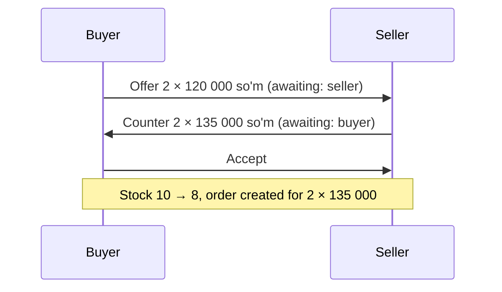
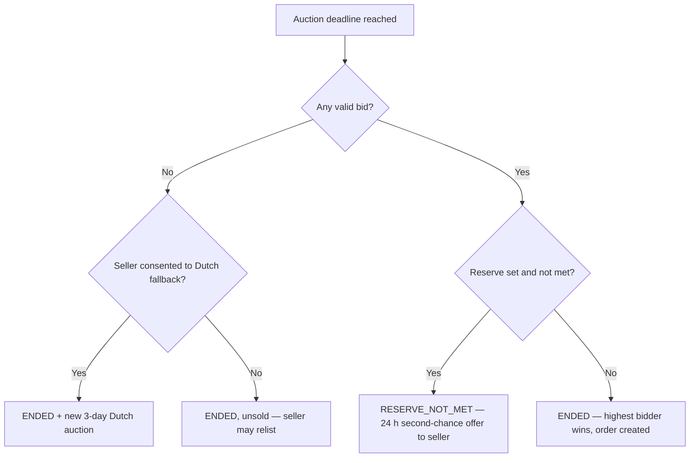
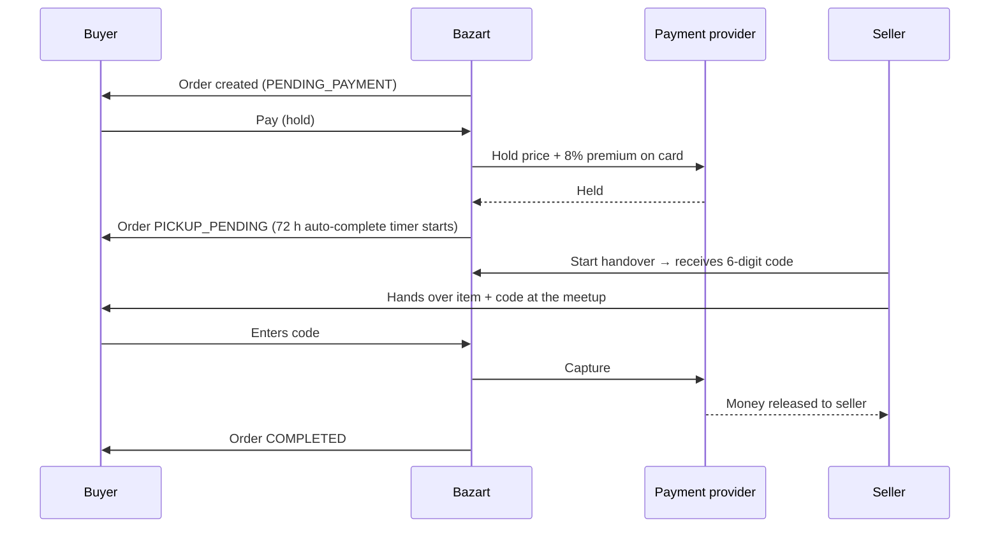

# Bazart — How the Whole Platform Works

An end-to-end description of Bazart: what it is, how a product gets listed, the two ways
it can be sold (**price offers** and **auctions**), and everything that happens after a
deal is made — order, escrow payment, handover, disputes and reviews.

This document describes the system **as implemented** (backend `app/`, frontend
`frontend/`). Deeper technical notes live in the other files in `docs/` and are linked
where relevant.

---

## Contents

1. [What Bazart is and the problem it solves](#1-what-bazart-is-and-the-problem-it-solves)
2. [Core rules that apply everywhere](#2-core-rules-that-apply-everywhere)
3. [People and accounts](#3-people-and-accounts)
4. [Listing a product (common to both methods)](#4-listing-a-product-common-to-both-methods)
5. [Choosing how to sell](#5-choosing-how-to-sell)
6. [Method A — Offer Marketplace (price offers)](#6-method-a--offer-marketplace-price-offers)
7. [Method B — Auction Marketplace](#7-method-b--auction-marketplace)
   - 7.1 [Ascending (English) auction](#71-ascending-english-auction)
   - 7.2 [Descending (Dutch) auction](#72-descending-dutch-auction)
   - 7.3 [Hybrid: unsold auction → Dutch auction](#73-hybrid-unsold-auction--dutch-auction)
   - 7.4 [Scheduling and changing the mode before start](#74-scheduling-and-changing-the-mode-before-start)
   - 7.5 [How an auction ends](#75-how-an-auction-ends)
8. [After the deal: order, payment, handover, completion](#8-after-the-deal-order-payment-handover-completion)
9. [Disputes, cancellations and refunds](#9-disputes-cancellations-and-refunds)
10. [Reviews and seller rating](#10-reviews-and-seller-rating)
11. [Staying informed: watchlist, notifications, real-time, messages](#11-staying-informed-watchlist-notifications-real-time-messages)
12. [Trust, safety and moderation](#12-trust-safety-and-moderation)
13. [Background jobs](#13-background-jobs)
14. [Status reference](#14-status-reference)
15. [API map](#15-api-map)
16. [Known limitations and open items](#16-known-limitations-and-open-items)

---

## 1. What Bazart is and the problem it solves

Bazart is a consumer-to-consumer marketplace for Uzbekistan.

**The problem.** On classic classifieds sites (OLX and similar) a listing has no end date.
A seller posts a price, nobody reacts, the price never moves, and the item sits for months.

**Bazart's answer.** Every listing has a **mandatory deadline** (3, 5 or 7 days) and a price
that actually responds to demand, plus **escrow** so neither side has to trust a stranger:

| Selling method | How the price is found | Units | Typical use |
|---|---|---|---|
| **Offer Marketplace** (default) | Seller sets a reference price per unit; buyers propose their own price and quantity; seller accepts, rejects or counters | 1 or many | Most listings, stock of identical items |
| **Ascending auction** | Buyers bid upward; highest bid wins at the deadline | exactly 1 | Used / unique items, competition |
| **Descending (Dutch) auction** | Price drops on a schedule; the first buyer to click "Buy now" wins | exactly 1 | New items, fast sale |

Whichever method is used, the result is the same kind of **order**, paid through the same
**escrow** flow (section 8).

---

## 2. Core rules that apply everywhere

| Rule | What it means in practice |
|---|---|
| **Money is integer tiyin** | 1 so'm = 100 tiyin. All amounts are stored as whole numbers (`BIGINT`); floats are forbidden. The API sends money as a **string in tiyin**: `"6200050"` = 62 000.50 so'm. All arithmetic and rounding live in `app/money/`. |
| **Buyer premium 8%** | The buyer pays the deal price + 8% (`BUYER_PREMIUM_BPS = 800`), rounded down in the buyer's favour. Calculated only at payment time. |
| **Mandatory deadline** | Offer listings: 3/5/7 days. Auctions: 3/5/7 days (or explicit start/end). |
| **Escrow, but not held by Bazart** | Bazart has no banking licence. The payment provider (PSP) places a **hold** on the buyer's card; Bazart only orchestrates hold → capture/release. |
| **All times UTC** | Stored in UTC, displayed in `Asia/Tashkent`. |
| **No card numbers stored** | Only the PSP's token reference. |
| **State changes go through state machines** | Auction, order and payment statuses can only move along allowed transitions. |
| **Concurrency-safe** | Every action that changes price, stock or money locks the relevant database row (`SELECT … FOR UPDATE`) so two simultaneous requests cannot both succeed. |

---

## 3. People and accounts

### Roles

| Role | Can do |
|---|---|
| **User** | Buy and sell (any user can list items) |
| **Seller** | Same as user (legacy role) |
| **Admin** | Moderation: approve/reject listings, cancel auctions, invalidate bids, resolve disputes and complaints, block users, view fraud signals |
| **Superadmin** | Everything an admin can do |

### Registration and sign-in

- **Email + password** registration (`POST /auth/register`), then login → **access token
  (30 min)** + **refresh token (14 days)**. Logout revokes the token (Redis-backed blacklist).
- **Google sign-in** (`POST /auth/google`) when `GOOGLE_CLIENT_ID` is configured.
- **Email verification** and **password reset** by token.
- **Phone verification** by one-time SMS code (OTP).
- **Telegram linking** (`POST /users/me/telegram`) — lets Bazart deliver notifications to the
  user's Telegram chat.
- **Legal consent**: before a user's first bid, offer or purchase, the app asks them to
  accept the auction rules and the public offer and records the consent with its document
  version. (This is enforced in the web app, not yet by the API.)
- **Blocked users** (`is_active = false`) cannot list, bid, make offers, buy or relist.

Auth endpoints are rate-limited per IP (login 5/min; registration/reset use a separate
bucket).

---

## 4. Listing a product (common to both methods)

The seller fills in one form at **`/sell`**. Behind it the listing is created in steps:

```
1. POST /items                 → item created as DRAFT
2. POST /items/{id}/images     → photos uploaded (first one is the primary image)
3a. Offer method:   POST /items/{id}/publish      → item ACTIVE as an offer listing
3b. Auction method: POST /auctions                → auction created; item ACTIVE/SCHEDULED
```

If a step fails (for example an image upload), retrying reuses the already-created draft —
no duplicate items.

### What the seller enters

| Field | Notes |
|---|---|
| Title, description | Description up to 5 000 characters |
| Category | Suggested automatically from the title; can be changed |
| Condition | **New**, **Used** or **Refurbished**. For used items: either "no defects" or a short defects description |
| Region and district | Required region; district optional |
| Exact location, year, equipment (what's included), video link | Optional, depending on category |
| Photos | Images only (JPEG/PNG/WebP/GIF), size-limited; SVG/HTML rejected |
| **Price** | Offer method: **price per unit** (a reference, not a minimum). Auction: **starting price** |
| **Quantity** | Offer method only (1–10 000). Auctions always sell exactly one unit |
| **Duration** | 3, 5 or 7 days |

### Preview

Before publishing, the seller sees a full preview of the listing exactly as buyers will see
it, including the chosen selling method and all pricing settings. Drafts of the form are
auto-saved in the browser.

---

## 5. Choosing how to sell

On the sell form the seller picks **"Narx takliflari" (price offers)** — the default — or
**"Auksion" (auction)**. For auctions the seller also chooses the **price direction**, and
the form pre-selects a sensible default from the item's condition:

| Condition | Default auction mode | Pre-filled suggestions (editable) |
|---|---|---|
| **New** | **Descending (Dutch)** | Lowest price = 80% of start; hourly drop that reaches it ~12 h before the end |
| **Used / Refurbished** | **Ascending** with **Buy now** | Buy-now price = 130% of start |

Suggestions never overwrite a field the seller has edited.

---

## 6. Method A — Offer Marketplace (price offers)

The primary way to sell. The seller states what they would like per unit; buyers say what
they are willing to pay and for how many units; the two negotiate.

### 6.1 Seller publishes

- Item has `listing_type = offer`, a **price per unit** (`starting_price`, a reference only),
  `quantity_total` and `quantity_available`.
- Publishing sets the listing **ACTIVE** with a deadline `listing_ends_at` = now + 3/5/7 days.
- Quantity can be changed only while the item is still a draft.

### 6.2 Buyer makes an offer

On the listing page (`/item/{id}`) the buyer enters:

- **Quantity** (1 … units still available)
- **Price per unit** — **any positive amount**: below the seller's price, above it, below
  another buyer's offer. There is **no minimum, no bid increment, no "must beat the previous
  offer" rule, and no automatic rejection.**
- Optional message.

The form shows the total (quantity × unit price) and how the offer compares with the
seller's price — purely informational. The server computes the authoritative total.

Rules enforced by the server:

| Rule | Result if broken |
|---|---|
| Listing must be an active offer listing and not past its deadline | 409 |
| Buyer cannot offer on their own listing | 400 |
| Quantity ≤ units available | 409 |
| One **open** offer per buyer per listing (change it by countering or withdrawing) | 409 |
| Buyer must not be blocked | 403 (legal consent is collected by the app) |

The seller is notified ("Yangi narx taklifi").

### 6.3 Negotiation

Each offer stores its current terms and **whose turn it is** (`awaiting`: buyer or seller).
Only the party whose turn it is can accept or counter.



| Action | Who | Effect |
|---|---|---|
| **Accept** | Party whose turn it is | Deal made → order created (6.4) |
| **Counter** | Party whose turn it is | New quantity/price; turn passes to the other side; 48 h timer restarts |
| **Reject** | Seller (any time), buyer (only a counter-offer from the seller) | Offer closed |
| **Withdraw** | Buyer (any time while open) | Offer closed |

- An offer nobody answers **expires after 48 hours** (never later than the listing deadline).
- Every step is kept in the **negotiation history** (offer, counter, accept, reject,
  withdraw, expire, sold out, cancel) with the message attached.
- The buyer's name is **masked** for the seller until a deal is made.
- Everyone involved is notified at each step (new offer, counter-offer, accepted, closed).

### 6.4 Acceptance, stock and the order

Accepting runs as **one atomic transaction**:

1. Lock the listing row (`FOR UPDATE`), then the offer row (always in this order — no
   deadlocks).
2. Re-check: offer still open and not expired, listing still active and before its deadline,
   enough stock.
3. Reduce stock with a **conditional update**
   (`quantity_available = quantity_available − q WHERE quantity_available ≥ q`).
4. Mark the offer **ACCEPTED** and create the **order**: `quantity`, `unit_price`,
   `final_price = quantity × unit_price`.
5. If stock reaches 0 → listing **SOLD** and all other open offers are closed ("sold out").

**No overselling, proven.** Two layers protect the last units: the row lock and the
conditional update. A test fires 8 simultaneous acceptances at 3 units on separate database
connections: exactly 3 succeed. With the lock removed, the conditional update alone still
holds; with both removed the test fails (verified).

### 6.5 Listing deadline, cancellation, republishing

| Event | What happens |
|---|---|
| Deadline passes | Listing → **EXPIRED**, open offers expire. Seller can **republish** the remaining stock with a new 3/5/7-day deadline. |
| Seller cancels ("Bekor qilish") | Listing → **CANCELLED**, open offers closed; deals already made stay valid. |
| Admin rejects | Same as cancel; a rejected listing **cannot** be republished. |
| An order from an offer is cancelled (payment released/refused) | Its units **return to stock**; a sold-out listing becomes active again if still before its deadline. |

Deadlines are checked at the moment of every action, so correctness does not depend on the
background job; the job only tidies statuses and sends notifications.

### 6.6 Where buyers and sellers manage offers

- **`/offers`** — tabs **Kelgan** (received, as seller) and **Yuborilgan** (sent, as buyer);
  offers waiting for *your* answer are listed first. Notification links jump straight to
  the relevant offer.
- **`/item/{id}`** — buyers see their own offer; the seller sees every incoming offer with
  accept / reject / counter.
- **`/my/listings`** — stock left, link to offers, republish expired listings.

Details: `docs/OFFERS.md`.

---

## 7. Method B — Auction Marketplace

An auction always sells **one unit** (`quantity_total = 1`; multi-unit items must use
offers). Each auction has a **pricing mode**: `ascending` or `descending`.

### 7.1 Ascending (English) auction

The classic auction: bids push the price up; the highest bid at the deadline wins.

**Seller settings**

| Setting | Meaning |
|---|---|
| Starting price | Bidding starts here |
| Minimum bid increment | Seller's step; the platform may require a larger step (below) |
| Reserve price (optional) | Secret minimum. Never revealed — buyers only see "reserve met / not met" |
| Buy-now price (optional) | Fixed price to win immediately (rules below) |
| Dutch fallback (optional, secret) | If nobody bids, continue as a 3-day Dutch auction (7.3) |

**Placing a bid** (`POST /auctions/{id}/bids`)

- The bid must be ≥ **current price + step**. The step is the larger of the seller's
  increment and the **tiered platform increment**:

  | Current price | Minimum step |
  |---|---|
  | < 100 000 so'm | 5 000 so'm |
  | 100 000 – 500 000 | 10 000 |
  | 500 000 – 2 000 000 | 25 000 |
  | 2 000 000 – 10 000 000 | 100 000 |
  | > 10 000 000 | 250 000 |

- **Proxy (maximum) bidding:** a bidder may enter a secret maximum. When a rival bids, the
  system automatically raises the leader by one step, up to their maximum. The maximum is
  **never** exposed by the API. Ties go to the earlier bid.
- **Anti-sniping (soft close):** a bid in the last **2 minutes** extends the deadline by
  **2 minutes**, at most **10 times**, so last-second sniping does not work.
- Sellers cannot bid on their own lot (shill protection).
- A bid far above the current price (> 3×) is flagged in the UI as a possible typo before
  sending.
- An **idempotency key** prevents a retried network request from placing the bid twice.
- Every bid locks the auction row — two simultaneous bids cannot both win at the same price
  (tested with parallel connections).
- Outbid users are notified ("Sizni ortda qoldirishdi"), and everyone watching the lot page
  sees the new price live (WebSocket).

**Retracting and invalidating bids**

- A bidder may **retract** their own bid (e.g. a typo) — but not if they are currently
  leading and not near the end (inside the soft-close window).
- An admin may **invalidate** any bid (fraud), with a reason. The price is recalculated from
  the remaining valid bids.

**Buy now (ascending)**

- Available while the price is **below the reserve** (with no reserve: only until the first
  bid).
- Additionally refused if the leader's hidden proxy maximum already covers the reserve — that
  bidder has effectively agreed to pay the reserve and must not be bypassed (the refusal does
  not reveal the maximum).
- Buying ends the auction immediately, marks existing bids as outbid and notifies those
  bidders, and creates the order at the buy-now price.

### 7.2 Descending (Dutch) auction

The price starts high and **drops on a schedule**; the **first buyer to click "Buy now"
wins** at the current price. There are no bids.

**Seller settings:** starting price, **drop amount**, **drop interval** (15 min … 1 day) and
**lowest price** (the floor, stored as the reserve; must be below the start).

**The price is computed from time, never stored:**

```
current price = max(lowest price, starting price − (completed intervals × drop amount))
```

- No scheduled job "lowers" the price, so a delayed worker can never make the price wrong.
- The price **never** goes below the lowest price and only ever goes down.
- The floor itself stays hidden until the price actually reaches it.

**What the buyer sees** on the lot page:

- Current price and a **live countdown to the next drop** (the page refreshes the price from
  the server at each drop).
- A **price schedule**: "after 1 day: X so'm", "after 2 days: Y so'm", "at the end: Z so'm",
  plus a summary line such as *"Narx 3 kundan keyin X so'mgacha tushadi"* ("the price will
  drop to X so'm in 3 days").
- A hint that watching the lot sends a Telegram alert when the price drops.

**Buying** (`POST /auctions/{id}/buy-now`) is atomic: the auction row is locked, the price is
calculated **at that moment** under the lock, and the purchase, the closed auction and the
order are written in one transaction. If two buyers click at the same time, exactly one
succeeds; the other gets "someone was faster". Because the price only falls, nobody pays more
than the price they saw.

### 7.3 Hybrid: unsold auction → Dutch auction

When creating an ascending auction, the seller can give **prior consent**: "if nobody bids,
continue as a Dutch auction", plus the lowest price they would accept. If the auction then
ends **without a single valid bid**:

1. In the same transaction that closes it, the listing is copied (`relisted_from_id`) and a
   **3-day descending auction** opens for the copy.
2. Its price starts at the original starting price and drops **hourly**, reaching the
   seller's lowest price after about 60 hours (the last ~12 hours stay at the floor).
3. The old auction points to the new one (`continued_as_auction_id`); its page shows
   *"No bids — the lot continues as a descending auction"* with a link.
4. Watchers are moved to the new auction and notified, as is the seller.

The consent is **never shown to buyers** — if buyers knew the item would get cheaper without
bids, they would stop bidding. Auctions that sold, or ended below the reserve, never switch
(those use second chance, 7.5). The continuation itself has no further fallback.

### 7.4 Scheduling and changing the mode before start

- An auction can **start later** ("Keyinroq boshlash" on the sell form). It is **SCHEDULED**
  until its start time and then becomes **ACTIVE** automatically.
- Until it starts, the seller can switch it between ascending and descending and change
  buy-now / reserve / floor (**"Narx rejimi"** in *My listings*,
  `PATCH /auctions/{id}/pricing`). Once it has started, the rules are frozen so participants
  are treated fairly.

### 7.5 How an auction ends

At the deadline the closer job (or the seller's manual close) locks the auction and decides:



| Outcome | Next steps |
|---|---|
| **Sold** | Winner notified ("Auksionda yutdingiz"), seller notified ("Mahsulotingiz sotildi"); order created at the winning price. |
| **Reserve not met** | The seller gets **24 hours** to accept the highest bid anyway (**second chance**). Accepting creates the order. |
| **Unsold, no bids** | Seller can **relist**: a copy with a new price and duration, created in one transaction. UI suggestion: 10% below the old price, or the highest bid if there was one. A listing can be relisted only once; relisting closes any open second-chance offer, so an item can never be sold twice. |
| **Cancelled** | Sellers can cancel only auctions without bids; admins can cancel any auction that has not finished. |

---

## 8. After the deal: order, payment, handover, completion

Every successful sale — accepted offer, auction win, buy-now, Dutch purchase, second chance
— produces **one order** with the same lifecycle.



### 8.1 The order

| Field | Meaning |
|---|---|
| `auction_id` **or** `offer_id` | Exactly one source (database-enforced) |
| `quantity`, `unit_price` | Auctions: 1 × winning price |
| `final_price` | quantity × unit price — the deal amount |
| `status` | `pending_payment → pickup_pending → completed` (or `cancelled`) |
| `auto_complete_at` | Hold time + 72 h |

Order pages show "2 dona × 135 000 so'm" for multi-unit deals.

### 8.2 Payment (escrow hold)

- The buyer initiates a **hold** (`POST /payments/holds`). The **amount is computed by the
  server**: `final_price + 8% premium` — the client never sends the amount.
- The PSP blocks the money on the buyer's card; nothing moves to the seller yet.
- Every money operation carries an **idempotency key**: retrying the same request never
  creates a second hold.
- PSP status updates arrive by **signed webhook** only; unsigned or replayed webhooks are
  rejected (a fake "paid" would mean free goods).
- All money operations are written to an **audit log** (who, what, old/new state, IP).
- In local/test environments a **mock provider** can confirm payments; it is disabled in
  production by configuration.

When the hold succeeds the order becomes **PICKUP_PENDING** and the 72-hour auto-complete
timer starts.

### 8.3 Handover

1. The seller starts the handover (**local meetup** or **delivery**) and receives a
   **6-digit code** (cryptographically random).
2. At the meetup the seller hands over the item and gives the buyer the code.
3. The buyer enters the code to confirm receipt → the hold is **captured** (money goes to
   the seller) → order **COMPLETED**. Both the handover and the payment change in one
   consistent transaction.

### 8.4 Auto-complete

If the buyer neither confirms nor opens a dispute within **72 hours** of the hold, the
auto-complete job captures the payment and completes the order, so money is never frozen
forever. **Orders with an open dispute are never auto-completed.**

---

## 9. Disputes, cancellations and refunds

| Situation | Flow |
|---|---|
| **Problem with the item** (not received, not as described, damaged, fake, other) | While the money is still held, the buyer opens a **dispute**. An admin reviews it and decides: **buyer** → the hold is released (refund), order cancelled; **seller** → the hold is captured, order completed. The decision and the money movement are committed together. |
| **Payment released / hold cancelled** (dispute for buyer, PSP webhook, admin) | Order → **CANCELLED**. For offer deals the units **return to stock**. |
| **Seller or admin cancels an order** (allowed transitions only) | Order → **CANCELLED**; offer stock is restored. |

Order status changes are restricted by a state machine — for example a seller cannot push an
unpaid order into "completed".

---

## 10. Reviews and seller rating

After an order is **COMPLETED**, buyer and seller can each review the other once (1–5 stars
and a comment). The receiver's average rating and review count are recalculated in the same
transaction and shown on their public profile (`/users/{id}`).

---

## 11. Staying informed: watchlist, notifications, real-time, messages

### Watchlist

Buyers can **watch** auctions ("Kuzatish"); the list is at `/my/watchlist`.

### Notifications

Every notification is stored in-app (`/notifications`, bell icon) and also delivered to
**Telegram** (if the user linked the bot) and to the **push** channel. Telegram messages
end with a direct link to the lot, offer or order when `PUBLIC_SITE_URL` is set.

| Notification | Who receives it | When |
|---|---|---|
| **You've been outbid** | Previous leader | A higher bid arrives (names the lot and current price) |
| **2 hours left** | Watchers + active bidders | Once, 2 h before the deadline (not repeated after anti-sniping extensions) |
| **Price dropped** | Watchers of a Dutch auction | After a drop of at least 10% since the last alert, and once when the floor is reached — not on every hourly drop |
| **Dutch auction started** | Seller + watchers | An unsold auction continued as a Dutch auction |
| **Won / Sold** | Winner / seller | Auction or buy-now sale |
| **Second chance** | Seller | Reserve not met |
| **New offer / Counter-offer / Deal made / Offer closed** | Buyer and seller | Offer negotiation steps |
| **Payment, Handover, Dispute** | Parties | Escrow and dispute events |

### Real-time updates

Auction pages connect to a WebSocket (`/ws/auctions/{id}`, authenticated). New bids and
buy-now sales are pushed instantly, so prices and "sold" states update without reloading.

### Messages

Buyers can message the seller about a listing ("Yozish"); conversations are listed at
`/messages` with read state.

---

## 12. Trust, safety and moderation

- **Moderation:** admins approve or reject listings. Rejecting a listing also stops its live
  auction or closes its open offers; a rejected offer listing cannot be republished.
- **Complaints:** users can report an item, user, auction, message or order; admins review
  and resolve them.
- **Anti-fraud signals:** IP, device and user agent are recorded on bids and purchases; the
  admin panel flags patterns such as many accounts on one device/IP, shill overlap with the
  seller, and bid velocity.
- **Blocking:** admins can block users; blocked users cannot transact.
- **Privacy:** bidder names are masked in bid history; offer buyers are masked until a deal;
  reserve prices, proxy maximums and Dutch-fallback consent are never exposed.
- **Rate limits:** login, auth and bidding/offers each have their own per-IP limits (Redis, with an in-memory fallback).
- **Uploads:** only image types, size-limited.

---

## 13. Background jobs

They run as **Celery beat** tasks in production and as an optional in-process loop in
development. Each one is safe to run concurrently and idempotent.

| Job | Every | Does |
|---|---|---|
| Close auctions | ~5 s (closer) | Activates scheduled auctions whose start has come, then closes due auctions (sale / reserve not met / unsold / Dutch fallback) |
| Ending-soon reminder | 60 s | "2 hours left" notifications |
| Price-drop alerts | 5 min | "Price dropped" for Dutch auctions |
| Expire offers & listings | 60 s | Closes unanswered offers and past-deadline offer listings |
| Auto-complete | 5 min | Captures holds older than 72 h without a dispute |

Notification delivery (push, Telegram, email) is queued; without a broker it runs inline.

---

## 14. Status reference

### Item (`items.status`)

| Status | Meaning |
|---|---|
| `draft` | Created, not yet published |
| `scheduled` | Auction scheduled to start later |
| `active` | On sale |
| `sold` | Sold (auction) or all units sold (offers) |
| `expired` | Offer listing past its deadline with stock left (can be republished) |
| `cancelled` | Removed by seller/admin, or auction ended unsold |

### Auction (`auctions.status`)

`scheduled → active → ended | reserve_not_met | cancelled` (terminal states cannot change).

### Offer (`offers.status`)

`pending → accepted | rejected | withdrawn | expired`; `awaiting` = `buyer` or `seller`.

### Bid (`bids.status`)

`valid` (currently winning), `outbid`, `retracted` (by bidder), `invalidated` (by admin),
`cancelled`.

### Order (`orders.status`)

`pending_payment → pickup_pending → completed`, or `cancelled`. (`paid` is used by the simple
payment-intent path.)

### Payment (`payments.status`)

| Status | Meaning |
|---|---|
| `pending` / `processing` | Created / in progress at the PSP |
| `held` | Money blocked on the buyer's card (escrow) |
| `released` | Captured — money paid to the seller |
| `cancelled_hold` | Hold released back to the buyer |
| `paid` / `failed` / `refunded` | Simple payment-intent path outcomes |

### Dispute

`open → under_review → resolved_buyer | resolved_seller`.

---

## 15. API map

All endpoints are under `/api/v1`. Money fields are tiyin strings.

| Area | Main endpoints |
|---|---|
| Auth | `POST /auth/register`, `/auth/login`, `/auth/google`, `/auth/refresh`, `/auth/logout`, `GET /auth/me`, email verification, password reset, phone OTP |
| Users | `GET /users/me`, `POST /users/me/telegram`, public profiles |
| Items | `POST /items`, `GET /items` (filters incl. `listing_type`, `status`, region, search), `GET/PATCH/DELETE /items/{id}`, `POST /items/{id}/images`, `POST /items/{id}/publish` |
| Offers | `POST /items/{id}/offers`, `GET /items/{id}/offers`, `GET /offers?role=buyer\|seller`, `GET /offers/{id}`, `POST /offers/{id}/accept\|counter\|reject\|withdraw` |
| Auctions | `POST /auctions`, `GET /auctions`, `GET /auctions/{id}`, `PATCH /auctions/{id}/pricing`, `PATCH /auctions/{id}/status`, `POST /auctions/{id}/close`, `POST /auctions/{id}/buy-now`, `POST /auctions/{id}/relist`, `POST /auctions/{id}/second-chance/accept`, `GET/POST /auctions/{id}/bids` |
| Bids | retract (own), invalidate (admin) |
| Orders | `GET /orders/buyer`, `/orders/seller`, `/orders/{id}`, `PATCH /orders/{id}/status` |
| Payments | `POST /payments/holds`, `POST /payments/{id}/capture`, `POST /payments/{id}/release`, `POST /payments/webhooks/psp`, `GET /payments/orders/{order_id}`, payment methods, intents |
| Handover | `POST /handovers`, `POST /handovers/{order_id}/confirm`, `GET /handovers/{order_id}` |
| Disputes | `POST /disputes`, `GET /disputes`, `POST /disputes/{id}/resolve` (admin) |
| Reviews | `POST /reviews`, `GET /reviews/user/{user_id}` |
| Engagement | `/watchlist`, `/notifications`, `/messages`, `/complaints`, `/legal` |
| Reference | `/categories`, `/regions` |
| Admin | users, items (approve/reject), auctions, bids, orders, complaints, statistics, fraud signals |
| Real-time | `WS /ws/auctions/{id}` |

### Main frontend pages

`/` home · `/catalog/{category}` catalog (offers and auctions together) · `/item/{id}` offer
listing · `/lot/{id}` auction · `/sell` · `/offers` · `/orders`, `/orders/{id}` ·
`/my/listings` · `/my/watchlist` · `/notifications` · `/messages` ·
`/profile`, `/users/{id}` · `/admin/*`.

---

## 16. Known limitations and open items

| Item | Status |
|---|---|
| **Push notifications** | Abstraction only — no device tokens, no FCM/APNs/web-push yet. Telegram works. |
| **Real payment provider** | PSP adapter interface and signed webhooks exist; a production PSP still has to be connected. Mock payments are local/test only. |
| **Unpaid offer orders** | Do not time out yet — sold units can stay reserved by a buyer who never pays. |
| **Watchlist for offer listings** | Watchlist and "2 hours left" cover auctions only. |
| **Price-drop push for open pages** | Dutch auction pages refresh at each drop; there is no WebSocket broadcast for drops. |
| **Price schedule reveals the floor** | When the forecast reaches the lowest price, that price becomes visible (deliberate trade-off for transparency). |
| **Proxy bids vs reserve** | The engine does not raise the visible price to the reserve when a proxy maximum covers it; such an auction can close as "reserve not met" (buy-now already accounts for this). |
| **Legal consent** | Collected by the web app before the first bid/offer/purchase, not enforced by the API. |
| **Moderation gap** | Rejecting an *already-ended unsold* auction listing is not recorded, so it could still be relisted. |

The live backlog is maintained in `docs/ROADMAP.md`.
